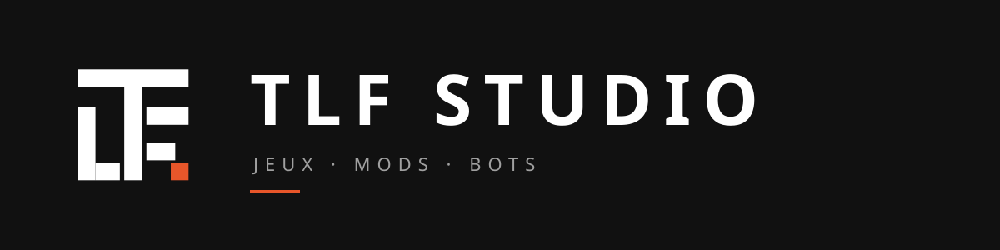

  

  <strong>Un studio indépendant qui fabrique des jeux, des mods et des bots.</strong> 
  TLF Studio est l'atelier de <a href="https://github.com/TALFADEV">talfa</a>. Des projets personnels, poussés jusqu'au bout, partagés avec la communauté.

  <a href="https://tlfstudio.fr">Site</a> ·
  <a href="https://discord.gg/XXXXXXX">Discord</a> ·
  <a href="https://youtube.com/@XXXXXXX">YouTube</a> ·
  <a href="https://twitch.tv/XXXXXXX">Twitch</a>

---

### Les branches

| | | |
|:---:|:---:|:---:|
| **Jeux vidéo** | **Mods & plugins** | **Bots & outils** |
| Des jeux originaux, conçus et développés de A à Z. | Des extensions pour les jeux qu'on aime : Minecraft, GTA V / LSPDFR, et d'autres. | Des bots Discord et des utilitaires pour les communautés et le studio. |

### Projets

Les projets seront dévoilés un par un sur [tlfstudio.fr](https://tlfstudio.fr). Rejoins le [Discord](https://discord.gg/XXXXXXX) pour ne rien rater.

### Participer

Le studio est solo aujourd'hui, et ouvert à des collaborations demain. Dev, artiste, testeur, musicien : fais-toi connaître sur [tlfstudio.fr/rejoindre](https://tlfstudio.fr/rejoindre) ou sur le Discord. Le programme de testeurs donne accès aux alphas avant tout le monde.

© TLF Studio — identité visuelle et assets dans <a href="https://github.com/tlf-studio/brand">tlf-studio/brand</a>

